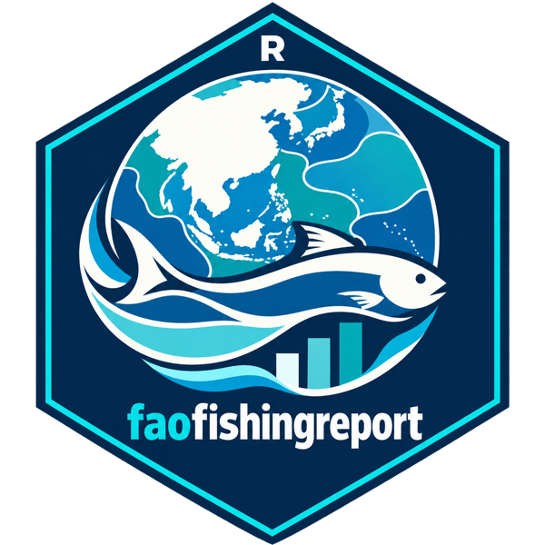
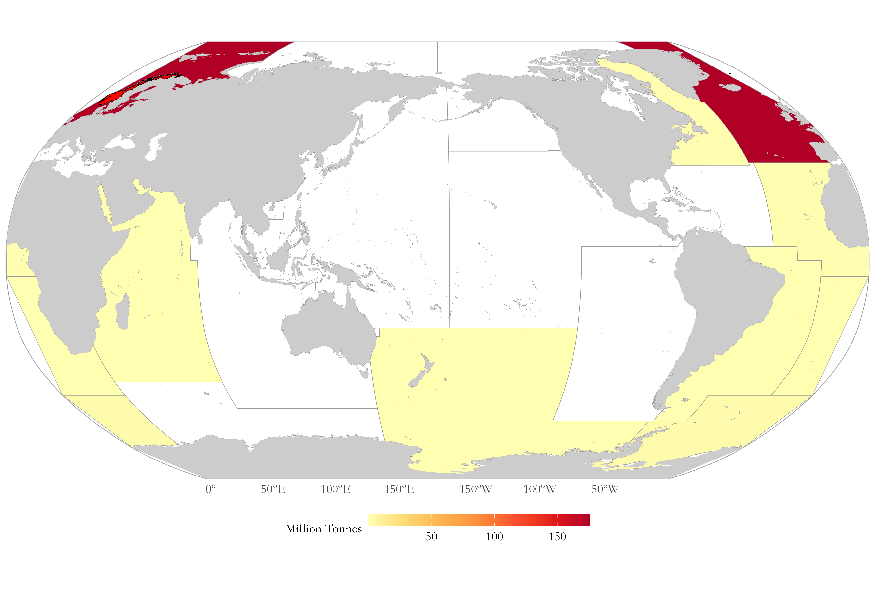

# faofishingreport 

<!-- badges: start -->
[](https://github.com/Linbojun99/faofishingreport)
[](https://linbojun99.github.io/faofishingreport/)
[](https://github.com/Linbojun99/faofishingreport/actions/workflows/R-CMD-check.yaml)
[](https://app.codecov.io/gh/Linbojun99/faofishingreport)
[](https://github.com/Linbojun99/faofishingreport/releases)
[](https://lifecycle.r-lib.org/articles/stages.html#experimental)
[](https://www.r-project.org/)
[](https://www.gnu.org/licenses/gpl-3.0)
<!-- badges: end -->

> 📘 **中文文档**：[faofishingreport 中文网站](https://linbojun99.github.io/faofishingreport/articles/zh/index.html)（网站右上角也可以随时切换中文）

**faofishingreport** turns the [FAO Global Capture Production](https://www.fao.org/fishery/collection/capture/en)
statistics into charts, maps and tables for reports, by fishing area, country and species,
in English, Chinese or both.

## ✨ Features

- 💾 **Always the latest data**: check for and download new FAO releases with one command.
- 🌊 **Fishing area reports**: total catch with breakpoints, main species, main countries, maps.
- 🐟 **Species and country profiles**: who catches a species, what a country catches, and where.
- 📊 **Nine summary analyses**: species group composition, stock status plots, peak and trend,
  data quality, diversity and concentration, country groups, synchronous breakpoints,
  coastal versus distant-water fleets, and an overview of all FAO marine areas.
- 🌐 **English, Chinese or bilingual** charts with the official FAO Chinese names.
- 🎨 **Your style**: themes, colour palettes, map projections (Robinson, Mollweide, Equal Earth, ...)
  and Pacific-centred maps, set once with `fao_settings()`.
- 💻 **Windows, macOS and Linux**: a Chinese font is chosen automatically; tables open in Excel
  with Chinese names intact.

## 📦 Installation

faofishingreport needs R 4.2 or later. Install it from GitHub:

```r
install.packages("remotes")
remotes::install_github("Linbojun99/faofishingreport")
```

For editable PowerPoint charts, also install eoffice: `install.packages("eoffice")` (on macOS it
also needs [XQuartz](https://www.xquartz.org)).

## 🚀 Quick start

```r
library(faofishingreport)

# Get the latest FAO release (only needed when FAO publishes a new one)
check_fao_update()
download_fao_data()

# FAO major fishing area 34, Eastern Central Atlantic
FAO34 <- fishing_area_data("Atlantic, Eastern Central")
fishing_area_species(FAO34$area_data, rank_range = c(1, 10))
fishing_area_country(FAO34$area_data, rank_range = c(1, 10))

# Who catches European pilchard, what Morocco catches
species_country(FAO34$area_data, "European pilchard(=Sardine)", lang = "both")
country_species(FAO34$area_data, "Morocco")

# Summary analyses
stock_status(FAO34$area_data)
coastal_distant(FAO34$area_data)
```

Charts are saved in `figures/png/` (and, if you want, editable PowerPoint in `figures/pptx/`),
tables in `tables/`.

## 🖼️ Examples

| Total catch and breakpoints | Stock status plot |
|---|---|
|  |  |
| **Bilingual charts** | **Robinson projection, Pacific-centred** |
|  |  |

## 🔧 Function reference

**💾 FAO data**

| Function | Description |
|---|---|
| `check_fao_update()` | Compare the latest FAO release online with the data on your computer |
| `download_fao_data()` | Download a release and convert it to the package format |
| `load_fao_data()` | Load the newest downloaded release, or the bundled data |
| `fao_data_dir()` | Folder where downloaded releases are stored |

**🌊 Fishing areas**

| Function | Description |
|---|---|
| `fishing_area_data()` | Catch of one FAO fishing area: trend, breakpoints, share of world catch, map |
| `fishing_area_species()` | Main species of an area, their catch and breakpoints |
| `fishing_area_country()` | Main countries of an area, their catch and breakpoints |

**🐟 Species and countries**

| Function | Description |
|---|---|
| `species_country()` | Countries catching a species: ranking, trends, map, pie charts by decade |
| `country_species()` | Species caught by a country in an area |
| `country_analysis()` | A country's catch in all FAO areas, by species and area, with a map |

**📊 Summary analyses**

| Function | Description |
|---|---|
| `species_group_composition()` | Catch by ISSCAAP species group or major group |
| `stock_status()` | Stock status plots: developing, exploited, over-exploited, collapsed, rebuilding |
| `peak_trend()` | Peak year, last year as % of peak and recent trend of species, countries or areas |
| `area_overview()` | All FAO marine areas compared |
| `data_quality()` | Official versus estimated catch, and catch identified to species |
| `diversity_concentration()` | Species and country numbers, Shannon diversity, HHI, top-N shares |
| `country_group_summary()` | Catch by income group, continent or region |
| `regime_shift()` | Breakpoints of the main species and years when many change together |
| `coastal_distant()` | Catch by coastal countries and distant-water fleets |

**🎨 Settings and language**

| Function | Description |
|---|---|
| `fao_settings()` | Language, theme, palettes, map projection and centre, grid lines, output |
| `fao_font()` | Font of chart text |
| `fao_translate()` | Chinese or bilingual names of countries, species and areas |

## 📖 Documentation

The [website](https://linbojun99.github.io/faofishingreport/) has a guide for every part of the package:
[🚀 Get started](https://linbojun99.github.io/faofishingreport/articles/get-started.html) ·
[💾 FAO data](https://linbojun99.github.io/faofishingreport/articles/data.html) ·
[🌊 Fishing areas](https://linbojun99.github.io/faofishingreport/articles/fishing-areas.html) ·
[🐟 Species and countries](https://linbojun99.github.io/faofishingreport/articles/species-countries.html) ·
[📈 Status and trends](https://linbojun99.github.io/faofishingreport/articles/status-trends.html) ·
[🔍 Quality, diversity and fleets](https://linbojun99.github.io/faofishingreport/articles/quality-diversity-fleets.html) ·
[🎨 Customise](https://linbojun99.github.io/faofishingreport/articles/customise.html)

## 📝 Citation

```r
citation("faofishingreport")
```

Please also cite FAO as the source of the data: FAO Fisheries and Aquaculture,
Global Capture Production (FishStat). FAO data are licensed under
[CC BY 4.0](https://creativecommons.org/licenses/by/4.0/).

## ⚖️ License

GPL-3 © Hongyu Lin
