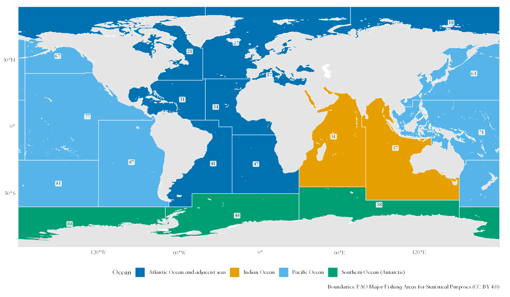
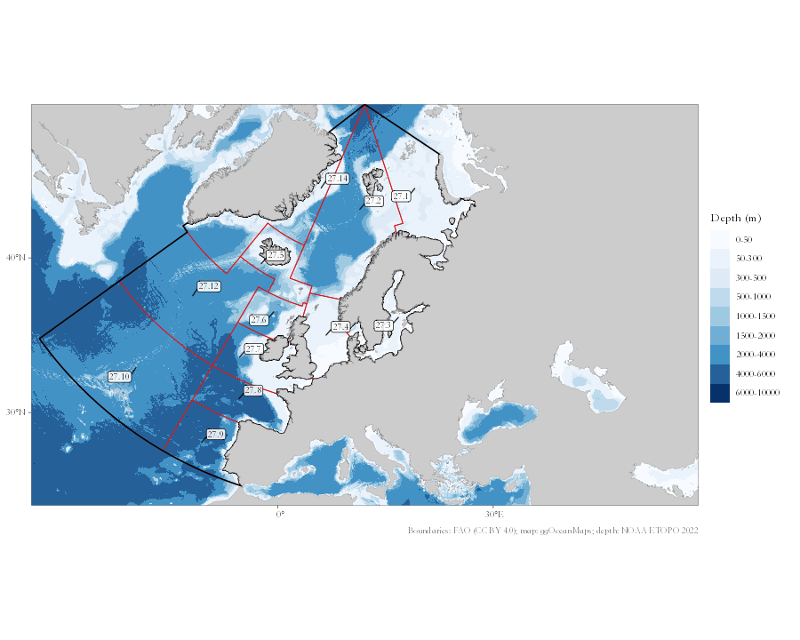
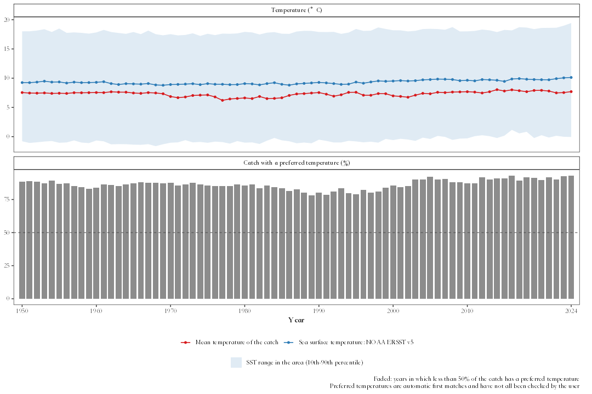

# faofishingreport 

<!-- badges: start -->
[](https://github.com/Linbojun99/faofishingreport)
[](https://linbojun99.github.io/faofishingreport/)
[](https://github.com/Linbojun99/faofishingreport/actions/workflows/R-CMD-check.yaml)
[](https://app.codecov.io/gh/Linbojun99/faofishingreport)
[](https://github.com/Linbojun99/faofishingreport/releases)
[](https://lifecycle.r-lib.org/articles/stages.html#experimental)
[](https://www.r-project.org/)
[](https://www.gnu.org/licenses/gpl-3.0)
<!-- badges: end -->

> 📘 **中文文档**：[faofishingreport 中文网站](https://linbojun99.github.io/faofishingreport/articles/zh/index.html)（网站右上角也可以随时切换中文）

**faofishingreport** turns the [FAO Global Capture Production](https://www.fao.org/fishery/collection/capture/en)
statistics into charts, maps and tables for reports, by fishing area, country and species,
in English, Chinese or both.

## 🌍 The FAO major fishing areas

FAO reports catches by **major fishing areas for statistical purposes**, defined by the
Coordinating Working Party on Fishery Statistics (CWP): **19 marine areas**, with two-digit codes
from 18 to 88, and the **inland waters** of each continent (01 Africa, 02 North America,
03 South America, 04 Asia, 05 Europe, 06 Oceania, 07 the former USSR area and 08 Antarctica).
Large areas are divided into subareas, divisions and subdivisions.



| Code | Area | Where | FAO map |
|---|---|---|---|
| **18** | Arctic Sea | Arctic Ocean, including Hudson Bay | [map](https://www.fao.org/fishery/docs/maps/fig_h2_18_0.gif) |
| **21** | Atlantic, Northwest | West Greenland, eastern Canada and the US east coast to about 35°N (Cape Hatteras) | [map](https://www.fao.org/fishery/docs/maps/fig_h2_21_0.gif) |
| **27** | Atlantic, Northeast | From the Barents Sea and East Greenland to the Strait of Gibraltar, with the North Sea and the Baltic Sea | [map](https://www.fao.org/fishery/docs/maps/fig_h2_27_0.gif) |
| **31** | Atlantic, Western Central | Gulf of Mexico, Caribbean Sea and the western Atlantic from about 35°N to northern Brazil | [map](https://www.fao.org/fishery/docs/maps/fig_h2_31_0.gif) |
| **34** | Atlantic, Eastern Central | West Africa from the Strait of Gibraltar to the Congo River, with the Canary Islands | [map](https://www.fao.org/fishery/docs/maps/fig_h2_34_0.gif) |
| **37** | Mediterranean and Black Sea | Mediterranean Sea, Sea of Marmara, Black Sea and Sea of Azov | [map](https://www.fao.org/fishery/docs/maps/fig_h2_37_0.gif) |
| **41** | Atlantic, Southwest | Brazil, Uruguay, Argentina and the Falkland Islands (Malvinas) | [map](https://www.fao.org/fishery/docs/maps/fig_h2_41_0.gif) |
| **47** | Atlantic, Southeast | Southwest Africa from the Congo River to South Africa (Angola, Namibia) | [map](https://www.fao.org/fishery/docs/maps/fig_h2_47_0.gif) |
| **48** | Atlantic, Antarctic | Atlantic sector of the Southern Ocean (South Georgia, Antarctic Peninsula) | [map](https://www.fao.org/fishery/docs/maps/fig_h5_48_0.gif) |
| **51** | Indian Ocean, Western | East Africa, Mozambique Channel, Red Sea, Persian Gulf, Arabian Sea and western India | [map](https://www.fao.org/fishery/docs/maps/fig_h3_51_0.gif) |
| **57** | Indian Ocean, Eastern | Bay of Bengal, Andaman Sea, south of Indonesia, and western and southern Australia | [map](https://www.fao.org/fishery/docs/maps/fig_h3_57_0.gif) |
| **58** | Indian Ocean, Antarctic | Indian Ocean sector of the Southern Ocean (Kerguelen) | [map](https://www.fao.org/fishery/docs/maps/fig_h5_58_0.gif) |
| **61** | Pacific, Northwest | China, Korea, Japan and the Russian Far East: northern South China Sea, East China and Yellow Seas, Sea of Japan, Sea of Okhotsk and the western Bering Sea | [map](https://www.fao.org/fishery/docs/maps/fig_h4_61_0.gif) |
| **67** | Pacific, Northeast | Eastern Bering Sea, Gulf of Alaska and the coasts of Canada and the United States to 40°N | [map](https://www.fao.org/fishery/docs/maps/fig_h4_67_0.gif) |
| **71** | Pacific, Western Central | Southern South China Sea, Gulf of Thailand, Indonesia, the Philippines, Papua New Guinea, Arafura Sea and the western Pacific islands | [map](https://www.fao.org/fishery/docs/maps/fig_h4_71_0.gif) |
| **77** | Pacific, Eastern Central | From California (south of 40°N) to Panama, and the central Pacific with Hawaii | [map](https://www.fao.org/fishery/docs/maps/fig_h4_77_0.gif) |
| **81** | Pacific, Southwest | Tasman Sea, New Zealand and the southwestern Pacific | [map](https://www.fao.org/fishery/docs/maps/fig_h4_81_0.gif) |
| **87** | Pacific, Southeast | Ecuador, Peru and Chile | [map](https://www.fao.org/fishery/docs/maps/fig_h4_87_0.gif) |
| **88** | Pacific, Antarctic | Pacific sector of the Southern Ocean (Ross Sea) | [map](https://www.fao.org/fishery/docs/maps/fig_h5_88_0.gif) |

The maps are the official FAO maps of each area
([FAO fishing area maps](https://www.fao.org/fishery/docs/maps/Default.htm)). `fao_areas()`
gives this list with the catch of each area, and `fishing_area_map()` maps one area with its
subareas, on the bathymetric base map of [ggOceanMaps](https://github.com/MikkoVihtakari/ggOceanMaps)
when it is installed. The examples below use the **Northeast Atlantic (area 27)**:



## ✨ Features

- 💾 **Always the latest data**: check for and download new FAO releases with one command, and
  compare releases to see what FAO revised.
- 🌊 **Fishing area analyses**: total catch with breakpoints, share of the world marine catch,
  main species, main countries, maps.
- 🐟 **Species and country profiles**: who catches a species, what a country catches, where it
  fishes and how far its distant-water fleet goes.
- 📊 **Summary analyses**: species groups, stock status plots, peak and trend, data quality,
  diversity and concentration, country groups, synchronous breakpoints, coastal and distant-water
  fleets, pelagic to demersal ratio, and all FAO marine areas compared.
- 🔬 **Analyses from the literature**: catch shocks (Cottrell et al. 2019; Gephart et al. 2017),
  fishery collapses (Mullon et al. 2005; Worm et al. 2006) with a random null model, synchrony
  and portfolio effect (Loreau & de Mazancourt 2008).
- 🌡️ **FishBase and sea temperature**: FishBase and SeaLifeBase traits matched to FAO species
  (data snapshots of the [rfishbase](https://github.com/ropensci/rfishbase) project), sea surface temperature of the FAO areas, and the mean temperature of the catch
  (Cheung et al. 2013).
- 📉 **CMSY++ stock assessment** of the main species (Froese et al. 2023; code of its authors from
  <https://github.com/SISTA16/cmsyPlusPlus>, bundled unchanged), with JAGS set up for
  your computer, charts, projections and tables of reference points and priors.
- 📝 **Assessment report in one call**: `fao_report()` writes a report in Chinese or English, as
  Word, LaTeX or PDF
  (cover, abstract, data and methods, results, conclusions, references, appendix), with every
  analysis switched on or off and the settings of each function given with a prefix.
- 🌐 **English, Chinese or bilingual** charts with the official FAO Chinese names.
- 🎨 **Your style**: themes, colour palettes, map projections (Robinson, Mollweide, Equal Earth, ...)
  and Pacific-centred maps, set once with `fao_settings()`.
- 💻 **Windows, macOS and Linux**: a Chinese font is chosen automatically; tables open in Excel
  with Chinese names intact.

## 📦 Installation

faofishingreport needs R 4.2 or later. Install it from GitHub:

```r
install.packages("remotes")
remotes::install_github("Linbojun99/faofishingreport", dependencies = TRUE)
```

All the packages it uses are installed with it (Word reports, PowerPoint, FishBase, sea surface
temperature, CMSY++). CMSY++ also needs the JAGS program: run `cmsy_setup()` once. On macOS,
editable PowerPoint charts need [XQuartz](https://www.xquartz.org).

## 🚀 Quick start

```r
library(faofishingreport)

# Get the latest FAO release (only needed when FAO publishes a new one)
check_fao_update()
download_fao_data()

# All FAO major fishing areas, and area 27 (Northeast Atlantic) with its subareas
fao_areas()
fishing_area_map(27)

# FAO major fishing area 27, Northeast Atlantic
FAO27 <- fishing_area_data("Atlantic, Northeast")
fishing_area_species(FAO27$area_data, rank_range = c(1, 10))
fishing_area_country(FAO27$area_data, rank_range = c(1, 10))

# Who catches Atlantic cod, what Norway catches
species_country(FAO27$area_data, "Atlantic cod", lang = "both")
country_species(FAO27$area_data, "Norway")

# Summary analyses and analyses from the literature
stock_status(FAO27$area_data)
catch_shocks(FAO27$area_data)
mean_temperature_catch(FAO27$area_data, version = "builtin")

# CMSY++ for the ten main species (run cmsy_setup() once before)
cmsy_area("Atlantic, Northeast", top = 10)

# An assessment report of the area, in Chinese, with CMSY++ and catch shocks,
# as Word and PDF (LaTeX)
report <- fao_report(27, lang = "zh", cmsy = TRUE, shocks = TRUE, format = c("docx", "pdf"))
```

Charts are saved in `figures/png/` (and, if you want, editable PowerPoint in `figures/pptx/`),
tables in `tables/`.

## 🖼️ Examples

| Total catch and breakpoints | Stock status plot |
|---|---|
|  |  |
| **Bilingual charts** | **Robinson projection, Pacific-centred** |
|  |  |
| **CMSY++ Kobe plot of the ten main species** | **Mean temperature of the catch and sea surface temperature** |
|  |  |

## 🔧 Function reference

**💾 FAO data**

| Function | Description |
|---|---|
| `check_fao_update()` | Compare the latest FAO release online with the data on your computer |
| `download_fao_data()` | Download a release and convert it to the package format |
| `load_fao_data()` | Load the newest downloaded release, or the bundled data |
| `fao_data_info()` | The FAO release used, its download link and citation |
| `fao_data_dir()` | Folder where downloaded releases are stored |

**🌊 Fishing areas**

| Function | Description |
|---|---|
| `fao_areas()` | All FAO major fishing areas: code, name, ocean, catch and link to the official FAO map, with a world map |
| `fishing_area_map()` | Map of one area with its subareas, divisions or subdivisions (bathymetry with ggOceanMaps) |
| `fishing_area_data()` | Catch of one FAO fishing area: trend, breakpoints, share of the world marine catch, map |
| `fishing_area_species()` | Main species of an area, their catch and breakpoints |
| `fishing_area_country()` | Main countries of an area, their catch and breakpoints |

**🐟 Species and countries**

| Function | Description |
|---|---|
| `species_country()` | Countries catching a species: ranking, trends, map, pie charts by decade |
| `country_species()` | Species caught by a country in an area |
| `country_analysis()` | A country's catch in all FAO areas, by species and area, with a map |

**📊 Summary analyses**

| Function | Description |
|---|---|
| `species_group_composition()` | Catch by ISSCAAP species group or major group |
| `stock_status()` | Stock status plots: developing, exploited, over-exploited, collapsed, rebuilding |
| `peak_trend()` | Peak year, last year as % of peak and recent trend of species, countries or areas |
| `area_overview()` | All FAO marine areas compared |
| `data_quality()` | Official versus estimated catch, and catch identified to species |
| `diversity_concentration()` | Species and country numbers, Shannon diversity, HHI, top-N shares |
| `country_group_summary()` | Catch by income group, continent or region |
| `regime_shift()` | Breakpoints of the main species and years when many change together |
| `coastal_distant()` | Catch by coastal countries and distant-water fleets |

**🔬 Analyses from the literature**

| Function | Description |
|---|---|
| `catch_shocks()` | Catch shocks (Cottrell et al. 2019 or Gephart et al. 2017), by year and group |
| `collapse_analysis()` | Fishery collapses (Mullon et al. 2005 or Worm et al. 2006) against random series |
| `catch_synchrony()` | Synchrony of species or country catches and the portfolio effect |
| `distant_water_profile()` | A country's catch in adjacent and distant-water FAO areas over time |
| `compare_releases()` | Records revised, added or removed between two FAO releases |
| `pelagic_demersal()` | Pelagic to demersal catch ratio (Caddy 1993; de Leiva Moreno et al. 2000) |
| `fao_pd_groups()` | ISSCAAP groups counted as pelagic or demersal |

**🌡️ FishBase and temperature**

| Function | Description |
|---|---|
| `check_fishbase_update()` | Latest FishBase and SeaLifeBase releases and the ones downloaded |
| `download_fishbase_data()` | Download FishBase and SeaLifeBase tables |
| `fishbase_table()` | Read a FishBase or SeaLifeBase table |
| `fishbase_match()` | Match FAO species items to FishBase and SeaLifeBase, with their traits |
| `fishbase_sources()` | Sources, licences and matching rules of the traits |
| `fao_sst_products()` | Sea surface temperature products and their references |
| `download_sst_data()` | Download a sea surface temperature product |
| `fao_area_sst()` | Sea surface temperature of the FAO areas by year |
| `mean_temperature_catch()` | Mean temperature of the catch and its trend, compared with SST |

**📉 CMSY++ stock assessment**

| Function | Description |
|---|---|
| `cmsy_area()` | CMSY++ for the main species of an area in one call |
| `cmsy_system()` | Check the computer: R, JAGS and the packages CMSY++ needs |
| `cmsy_setup()` | Install JAGS and the R packages of CMSY++ |
| `cmsy_jags_versions()` | JAGS and rjags versions that match each R version |
| `cmsy_download_jags()` | Download the JAGS installer for the computer |
| `cmsy_install_jags()` | Install JAGS |
| `cmsy_sources()` | Versions, links and citations of everything CMSY++ uses |
| `cmsy_priors()` | Priors of r from FishBase and SeaLifeBase |
| `cmsy_input()` | FAO catch data to CMSY++ input files |
| `cmsy_defaults()` | CMSY++ settings and their defaults |
| `cmsy_run()` | Run CMSY++ |
| `cmsy_plot()` | Charts of the CMSY++ results |
| `cmsy_forecast()` | Projections under fishing scenarios |
| `cmsy_compare()` | Compare CMSY++ runs |
| `cmsy_tables()` | Tables of priors and results for reports |

**📝 Reports**

| Function | Description |
|---|---|
| `fao_report()` | Word assessment report of a fishing area, in Chinese or English, with every analysis switched on or off |

**🎨 Settings and language**

| Function | Description |
|---|---|
| `fao_settings()` | Language, theme, palettes, map projection and centre, grid lines, output |
| `fao_font()` | Font of chart text |
| `fao_translate()` | Chinese or bilingual names of countries, species and areas |

## 📖 Documentation

The [website](https://linbojun99.github.io/faofishingreport/) has a guide for every part of the package.

**🧭 Start here**

- [🚀 Get started](https://linbojun99.github.io/faofishingreport/articles/get-started.html)
- [🎓 Tutorial: FAO area 67 from zero to a report](https://linbojun99.github.io/faofishingreport/articles/tutorial-67.html)

**📊 Data and analyses**

- [💾 FAO data](https://linbojun99.github.io/faofishingreport/articles/data.html)
- [🌊 Fishing areas](https://linbojun99.github.io/faofishingreport/articles/fishing-areas.html)
- [🐟 Species and countries](https://linbojun99.github.io/faofishingreport/articles/species-countries.html)
- [📈 Status and trends](https://linbojun99.github.io/faofishingreport/articles/status-trends.html)
- [🔍 Quality, diversity and fleets](https://linbojun99.github.io/faofishingreport/articles/quality-diversity-fleets.html)
- [🔬 Shocks, collapses, synchrony and fleets](https://linbojun99.github.io/faofishingreport/articles/literature-analyses.html)
- [🌡️ Sea temperature and catch temperature](https://linbojun99.github.io/faofishingreport/articles/sst-mtc.html)
- [🐠 FishBase traits](https://linbojun99.github.io/faofishingreport/articles/fishbase.html)

**📝 Assessment and report**

- [📉 CMSY++](https://linbojun99.github.io/faofishingreport/articles/cmsy.html)
- [📝 Word report](https://linbojun99.github.io/faofishingreport/articles/report.html)

**🧰 More**

- [🎨 Customise](https://linbojun99.github.io/faofishingreport/articles/customise.html)
- 🧩 Extension (not in the Word report): [🚢 Trade and employment](https://linbojun99.github.io/faofishingreport/articles/trade-employment.html)

Every guide ends with the references of the methods and data it uses, with their DOI or link.

## 📊 Data source

The package comes with the FAO [Global Capture Production](https://www.fao.org/fishery/collection/capture/en)
statistics, **release 2026.1.0** (published by FAO on 30 March 2026; catches 1950–2024),
downloaded on 10 October 2026 from
<https://www.fao.org/fishery/static/Data/Capture_2026.1.0.zip>.

- All releases: <https://www.fao.org/fishery/static/Data/>. `check_fao_update()` and
  `download_fao_data()` find and download newer ones.
- Species names: FAO [ASFIS list](https://www.fao.org/fishery/static/ASFIS/ASFIS_sp.zip);
  Chinese names of countries, species and areas from the FAO code lists in the release.
- Licence: [CC BY 4.0](https://creativecommons.org/licenses/by/4.0/), with the
  [FAO terms of use](https://www.fao.org/contact-us/terms/db-terms-of-use/en).
- `fao_data_info()` shows the release your analyses use and how to cite it.
- FAO websites: [FAO](https://www.fao.org/home/en),
  [FAOSTAT data](https://www.fao.org/faostat/en/#data) and the
  [FAO fishery data files](https://www.fao.org/fishery/static/Data/).

> This package is not affiliated with FAO; the data come from FAO.

## 📝 Citation

```r
citation("faofishingreport")
```

Please also cite the FAO data, e.g. with the citation given by `fao_data_info()`:

> FAO. 2026. Global Capture Production 1950-2024, release 2026.1.0. In: Fisheries and
> Aquaculture [online]. Rome. [Cited 10 October 2026].
> https://www.fao.org/fishery/collection/capture/en. Licence: CC BY 4.0.

## ⚖️ License

GPL-3 © Hongyu Lin
