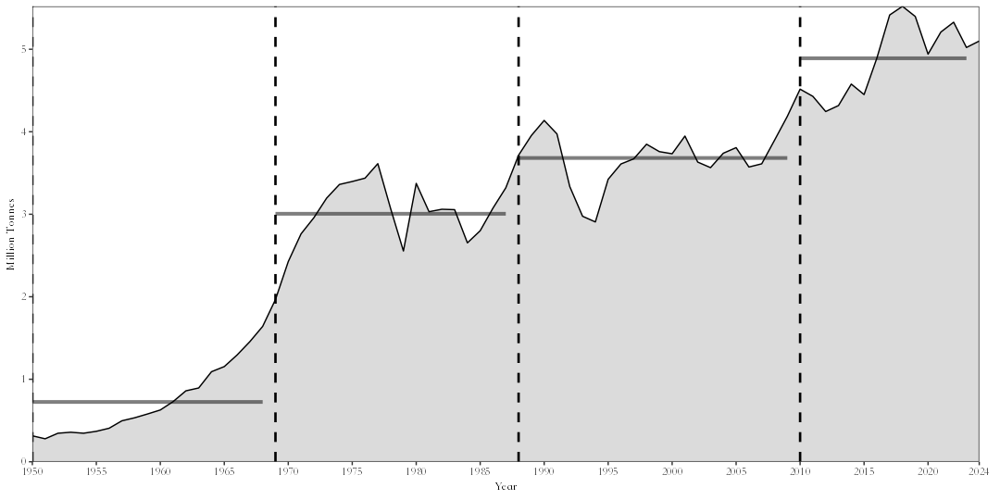
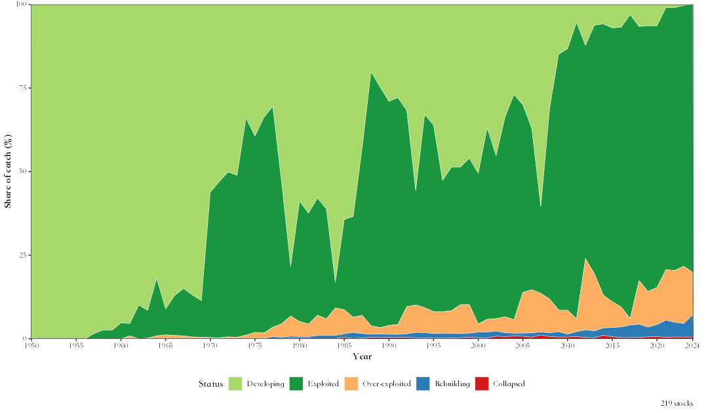
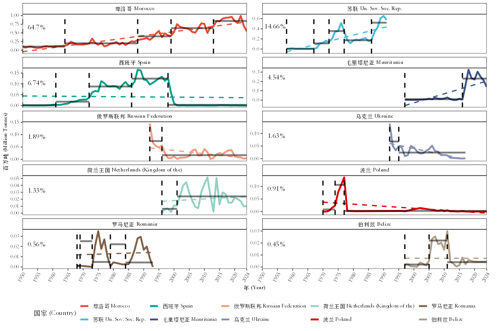
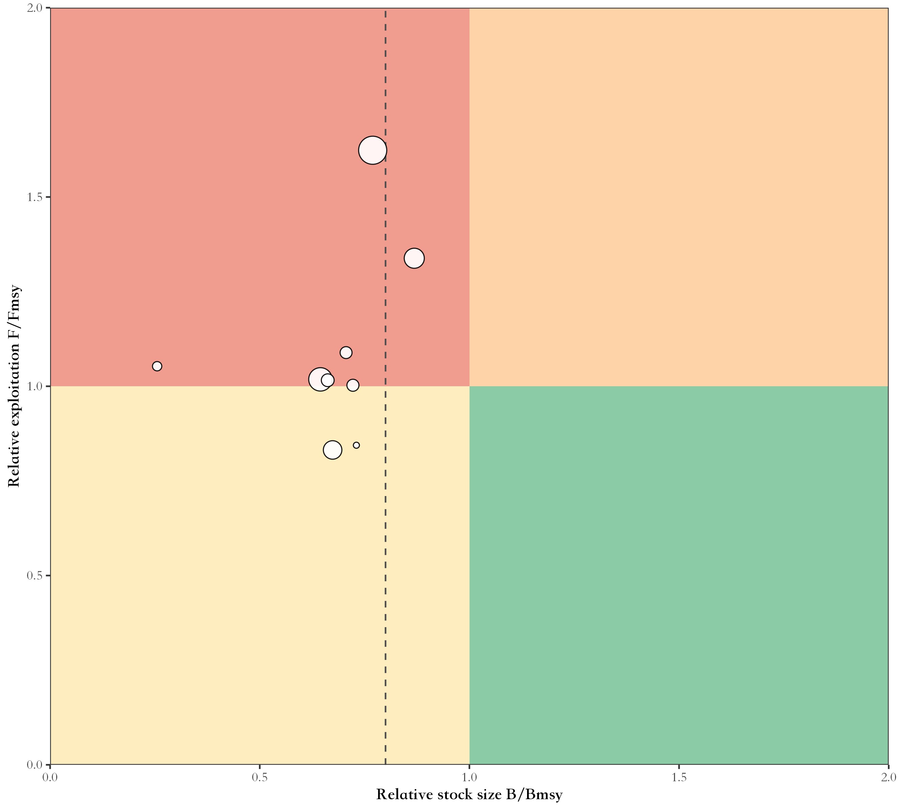

# faofishingreport

> 📘 **中文文档**：[faofishingreport
> 中文网站](https://linbojun99.github.io/faofishingreport/articles/zh/index.html)（网站右上角也可以随时切换中文）

**faofishingreport** turns the [FAO Global Capture
Production](https://www.fao.org/fishery/collection/capture/en)
statistics into charts, maps and tables for reports, by fishing area,
country and species, in English, Chinese or both.

## ✨ Features

- 💾 **Always the latest data**: check for and download new FAO releases
  with one command, and compare releases to see what FAO revised.
- 🌊 **Fishing area analyses**: total catch with breakpoints, share of
  the world marine catch, main species, main countries, maps.
- 🐟 **Species and country profiles**: who catches a species, what a
  country catches, where it fishes and how far its distant-water fleet
  goes.
- 📊 **Summary analyses**: species groups, stock status plots, peak and
  trend, data quality, diversity and concentration, country groups,
  synchronous breakpoints, coastal and distant-water fleets, pelagic to
  demersal ratio, and all FAO marine areas compared.
- 🔬 **Analyses from the literature**: catch shocks (Cottrell et
  al. 2019; Gephart et al. 2017), fishery collapses (Mullon et al. 2005;
  Worm et al. 2006) with a random null model, synchrony and portfolio
  effect (Loreau & de Mazancourt 2008).
- 🌡️ **FishBase and sea temperature**: FishBase and SeaLifeBase traits
  matched to FAO species (data snapshots of the
  [rfishbase](https://github.com/ropensci/rfishbase) project), sea
  surface temperature of the FAO areas, and the mean temperature of the
  catch (Cheung et al. 2013).
- 📉 **CMSY++ stock assessment** of the main species (Froese et
  al. 2023; code of its authors from
  <https://github.com/SISTA16/cmsyPlusPlus>, bundled unchanged), with
  JAGS set up for your computer, charts, projections and tables of
  reference points and priors.
- 📝 **Assessment report in one call**:
  [`fao_report()`](https://linbojun99.github.io/faofishingreport/reference/fao_report.md)
  writes a report in Chinese or English, as Word, LaTeX or PDF (cover,
  abstract, data and methods, results, conclusions, references,
  appendix), with every analysis switched on or off and the settings of
  each function given with a prefix.
- 🌐 **English, Chinese or bilingual** charts with the official FAO
  Chinese names.
- 🎨 **Your style**: themes, colour palettes, map projections (Robinson,
  Mollweide, Equal Earth, …) and Pacific-centred maps, set once with
  [`fao_settings()`](https://linbojun99.github.io/faofishingreport/reference/fao_settings.md).
- 💻 **Windows, macOS and Linux**: a Chinese font is chosen
  automatically; tables open in Excel with Chinese names intact.

## 📦 Installation

faofishingreport needs R 4.2 or later. Install it from GitHub:

``` r

install.packages("remotes")
remotes::install_github("Linbojun99/faofishingreport", dependencies = TRUE)
```

All the packages it uses are installed with it (Word reports,
PowerPoint, FishBase, sea surface temperature, CMSY++). CMSY++ also
needs the JAGS program: run
[`cmsy_setup()`](https://linbojun99.github.io/faofishingreport/reference/cmsy_setup.md)
once. On macOS, editable PowerPoint charts need
[XQuartz](https://www.xquartz.org).

## 🚀 Quick start

``` r

library(faofishingreport)

# Get the latest FAO release (only needed when FAO publishes a new one)
check_fao_update()
download_fao_data()

# FAO major fishing area 34, Eastern Central Atlantic
FAO34 <- fishing_area_data("Atlantic, Eastern Central")
fishing_area_species(FAO34$area_data, rank_range = c(1, 10))
fishing_area_country(FAO34$area_data, rank_range = c(1, 10))

# Who catches European pilchard, what Morocco catches
species_country(FAO34$area_data, "European pilchard(=Sardine)", lang = "both")
country_species(FAO34$area_data, "Morocco")

# Summary analyses and analyses from the literature
stock_status(FAO34$area_data)
catch_shocks(FAO34$area_data)
mean_temperature_catch(FAO34$area_data, version = "builtin")

# CMSY++ for the ten main species (run cmsy_setup() once before)
cmsy_area("Atlantic, Eastern Central", top = 10)

# An assessment report of the area, in Chinese, with CMSY++ and catch shocks,
# as Word and PDF (LaTeX)
report <- fao_report(34, lang = "zh", cmsy = TRUE, shocks = TRUE, format = c("docx", "pdf"))
```

Charts are saved in `figures/png/` (and, if you want, editable
PowerPoint in `figures/pptx/`), tables in `tables/`.

## 🖼️ Examples

| Total catch and breakpoints | Stock status plot |
|----|----|
|  |  |
| **Bilingual charts** | **Robinson projection, Pacific-centred** |
|  |  |
| **CMSY++ Kobe plot of the ten main species** | **Mean temperature of the catch and sea surface temperature** |
|  |  |

## 🔧 Function reference

**💾 FAO data**

| Function | Description |
|----|----|
| [`check_fao_update()`](https://linbojun99.github.io/faofishingreport/reference/check_fao_update.md) | Compare the latest FAO release online with the data on your computer |
| [`download_fao_data()`](https://linbojun99.github.io/faofishingreport/reference/download_fao_data.md) | Download a release and convert it to the package format |
| [`load_fao_data()`](https://linbojun99.github.io/faofishingreport/reference/load_fao_data.md) | Load the newest downloaded release, or the bundled data |
| [`fao_data_info()`](https://linbojun99.github.io/faofishingreport/reference/fao_data_info.md) | The FAO release used, its download link and citation |
| [`fao_data_dir()`](https://linbojun99.github.io/faofishingreport/reference/fao_data_dir.md) | Folder where downloaded releases are stored |

**🌊 Fishing areas**

| Function | Description |
|----|----|
| [`fishing_area_data()`](https://linbojun99.github.io/faofishingreport/reference/fishing_area_data.md) | Catch of one FAO fishing area: trend, breakpoints, share of the world marine catch, map |
| [`fishing_area_species()`](https://linbojun99.github.io/faofishingreport/reference/fishing_area_species.md) | Main species of an area, their catch and breakpoints |
| [`fishing_area_country()`](https://linbojun99.github.io/faofishingreport/reference/fishing_area_country.md) | Main countries of an area, their catch and breakpoints |

**🐟 Species and countries**

| Function | Description |
|----|----|
| [`species_country()`](https://linbojun99.github.io/faofishingreport/reference/species_country.md) | Countries catching a species: ranking, trends, map, pie charts by decade |
| [`country_species()`](https://linbojun99.github.io/faofishingreport/reference/country_species.md) | Species caught by a country in an area |
| [`country_analysis()`](https://linbojun99.github.io/faofishingreport/reference/country_analysis.md) | A country’s catch in all FAO areas, by species and area, with a map |

**📊 Summary analyses**

| Function | Description |
|----|----|
| [`species_group_composition()`](https://linbojun99.github.io/faofishingreport/reference/species_group_composition.md) | Catch by ISSCAAP species group or major group |
| [`stock_status()`](https://linbojun99.github.io/faofishingreport/reference/stock_status.md) | Stock status plots: developing, exploited, over-exploited, collapsed, rebuilding |
| [`peak_trend()`](https://linbojun99.github.io/faofishingreport/reference/peak_trend.md) | Peak year, last year as % of peak and recent trend of species, countries or areas |
| [`area_overview()`](https://linbojun99.github.io/faofishingreport/reference/area_overview.md) | All FAO marine areas compared |
| [`data_quality()`](https://linbojun99.github.io/faofishingreport/reference/data_quality.md) | Official versus estimated catch, and catch identified to species |
| [`diversity_concentration()`](https://linbojun99.github.io/faofishingreport/reference/diversity_concentration.md) | Species and country numbers, Shannon diversity, HHI, top-N shares |
| [`country_group_summary()`](https://linbojun99.github.io/faofishingreport/reference/country_group_summary.md) | Catch by income group, continent or region |
| [`regime_shift()`](https://linbojun99.github.io/faofishingreport/reference/regime_shift.md) | Breakpoints of the main species and years when many change together |
| [`coastal_distant()`](https://linbojun99.github.io/faofishingreport/reference/coastal_distant.md) | Catch by coastal countries and distant-water fleets |

**🔬 Analyses from the literature**

| Function | Description |
|----|----|
| [`catch_shocks()`](https://linbojun99.github.io/faofishingreport/reference/catch_shocks.md) | Catch shocks (Cottrell et al. 2019 or Gephart et al. 2017), by year and group |
| [`collapse_analysis()`](https://linbojun99.github.io/faofishingreport/reference/collapse_analysis.md) | Fishery collapses (Mullon et al. 2005 or Worm et al. 2006) against random series |
| [`catch_synchrony()`](https://linbojun99.github.io/faofishingreport/reference/catch_synchrony.md) | Synchrony of species or country catches and the portfolio effect |
| [`distant_water_profile()`](https://linbojun99.github.io/faofishingreport/reference/distant_water_profile.md) | A country’s catch in adjacent and distant-water FAO areas over time |
| [`compare_releases()`](https://linbojun99.github.io/faofishingreport/reference/compare_releases.md) | Records revised, added or removed between two FAO releases |
| [`pelagic_demersal()`](https://linbojun99.github.io/faofishingreport/reference/pelagic_demersal.md) | Pelagic to demersal catch ratio (Caddy 1993; de Leiva Moreno et al. 2000) |
| [`fao_pd_groups()`](https://linbojun99.github.io/faofishingreport/reference/fao_pd_groups.md) | ISSCAAP groups counted as pelagic or demersal |

**🌡️ FishBase and temperature**

| Function | Description |
|----|----|
| [`check_fishbase_update()`](https://linbojun99.github.io/faofishingreport/reference/check_fishbase_update.md) | Latest FishBase and SeaLifeBase releases and the ones downloaded |
| [`download_fishbase_data()`](https://linbojun99.github.io/faofishingreport/reference/download_fishbase_data.md) | Download FishBase and SeaLifeBase tables |
| [`fishbase_table()`](https://linbojun99.github.io/faofishingreport/reference/fishbase_table.md) | Read a FishBase or SeaLifeBase table |
| [`fishbase_match()`](https://linbojun99.github.io/faofishingreport/reference/fishbase_match.md) | Match FAO species items to FishBase and SeaLifeBase, with their traits |
| [`fishbase_sources()`](https://linbojun99.github.io/faofishingreport/reference/fishbase_sources.md) | Sources, licences and matching rules of the traits |
| [`fao_sst_products()`](https://linbojun99.github.io/faofishingreport/reference/fao_sst_products.md) | Sea surface temperature products and their references |
| [`download_sst_data()`](https://linbojun99.github.io/faofishingreport/reference/download_sst_data.md) | Download a sea surface temperature product |
| [`fao_area_sst()`](https://linbojun99.github.io/faofishingreport/reference/fao_area_sst.md) | Sea surface temperature of the FAO areas by year |
| [`mean_temperature_catch()`](https://linbojun99.github.io/faofishingreport/reference/mean_temperature_catch.md) | Mean temperature of the catch and its trend, compared with SST |

**📉 CMSY++ stock assessment**

| Function | Description |
|----|----|
| [`cmsy_area()`](https://linbojun99.github.io/faofishingreport/reference/cmsy_area.md) | CMSY++ for the main species of an area in one call |
| [`cmsy_system()`](https://linbojun99.github.io/faofishingreport/reference/cmsy_system.md) | Check the computer: R, JAGS and the packages CMSY++ needs |
| [`cmsy_setup()`](https://linbojun99.github.io/faofishingreport/reference/cmsy_setup.md) | Install JAGS and the R packages of CMSY++ |
| [`cmsy_jags_versions()`](https://linbojun99.github.io/faofishingreport/reference/cmsy_jags_versions.md) | JAGS and rjags versions that match each R version |
| [`cmsy_download_jags()`](https://linbojun99.github.io/faofishingreport/reference/cmsy_download_jags.md) | Download the JAGS installer for the computer |
| [`cmsy_install_jags()`](https://linbojun99.github.io/faofishingreport/reference/cmsy_install_jags.md) | Install JAGS |
| [`cmsy_sources()`](https://linbojun99.github.io/faofishingreport/reference/cmsy_sources.md) | Versions, links and citations of everything CMSY++ uses |
| [`cmsy_priors()`](https://linbojun99.github.io/faofishingreport/reference/cmsy_priors.md) | Priors of r from FishBase and SeaLifeBase |
| [`cmsy_input()`](https://linbojun99.github.io/faofishingreport/reference/cmsy_input.md) | FAO catch data to CMSY++ input files |
| [`cmsy_defaults()`](https://linbojun99.github.io/faofishingreport/reference/cmsy_defaults.md) | CMSY++ settings and their defaults |
| [`cmsy_run()`](https://linbojun99.github.io/faofishingreport/reference/cmsy_run.md) | Run CMSY++ |
| [`cmsy_plot()`](https://linbojun99.github.io/faofishingreport/reference/cmsy_plot.md) | Charts of the CMSY++ results |
| [`cmsy_forecast()`](https://linbojun99.github.io/faofishingreport/reference/cmsy_forecast.md) | Projections under fishing scenarios |
| [`cmsy_compare()`](https://linbojun99.github.io/faofishingreport/reference/cmsy_compare.md) | Compare CMSY++ runs |
| [`cmsy_tables()`](https://linbojun99.github.io/faofishingreport/reference/cmsy_tables.md) | Tables of priors and results for reports |

**📝 Reports**

| Function | Description |
|----|----|
| [`fao_report()`](https://linbojun99.github.io/faofishingreport/reference/fao_report.md) | Word assessment report of a fishing area, in Chinese or English, with every analysis switched on or off |

**🎨 Settings and language**

| Function | Description |
|----|----|
| [`fao_settings()`](https://linbojun99.github.io/faofishingreport/reference/fao_settings.md) | Language, theme, palettes, map projection and centre, grid lines, output |
| [`fao_font()`](https://linbojun99.github.io/faofishingreport/reference/fao_font.md) | Font of chart text |
| [`fao_translate()`](https://linbojun99.github.io/faofishingreport/reference/fao_translate.md) | Chinese or bilingual names of countries, species and areas |

## 📖 Documentation

The [website](https://linbojun99.github.io/faofishingreport/) has a
guide for every part of the package: [🚀 Get
started](https://linbojun99.github.io/faofishingreport/articles/get-started.html)
· [🎓 Tutorial: FAO area 67 from zero to a
report](https://linbojun99.github.io/faofishingreport/articles/tutorial-67.html)
· [💾 FAO
data](https://linbojun99.github.io/faofishingreport/articles/data.html)
· [🌊 Fishing
areas](https://linbojun99.github.io/faofishingreport/articles/fishing-areas.html)
· [🐟 Species and
countries](https://linbojun99.github.io/faofishingreport/articles/species-countries.html)
· [📈 Status and
trends](https://linbojun99.github.io/faofishingreport/articles/status-trends.html)
· [🔍 Quality, diversity and
fleets](https://linbojun99.github.io/faofishingreport/articles/quality-diversity-fleets.html)
· [🔬 Shocks, collapses, synchrony and
fleets](https://linbojun99.github.io/faofishingreport/articles/literature-analyses.html)
· [🌡️ Sea temperature and catch
temperature](https://linbojun99.github.io/faofishingreport/articles/sst-mtc.html)
· [🐠 FishBase
traits](https://linbojun99.github.io/faofishingreport/articles/fishbase.html)
· [📉
CMSY++](https://linbojun99.github.io/faofishingreport/articles/cmsy.html)
· [📝 Word
report](https://linbojun99.github.io/faofishingreport/articles/report.html)
· [🎨
Customise](https://linbojun99.github.io/faofishingreport/articles/customise.html)

Every guide ends with the references of the methods and data it uses,
with their DOI or link.

## 📊 Data source

The package comes with the FAO [Global Capture
Production](https://www.fao.org/fishery/collection/capture/en)
statistics, **release 2026.1.0** (published by FAO on 30 March 2026;
catches 1950–2024), downloaded on 10 October 2026 from
<https://www.fao.org/fishery/static/Data/Capture_2026.1.0.zip>.

- All releases: <https://www.fao.org/fishery/static/Data/>.
  [`check_fao_update()`](https://linbojun99.github.io/faofishingreport/reference/check_fao_update.md)
  and
  [`download_fao_data()`](https://linbojun99.github.io/faofishingreport/reference/download_fao_data.md)
  find and download newer ones.
- Species names: FAO [ASFIS
  list](https://www.fao.org/fishery/static/ASFIS/ASFIS_sp.zip); Chinese
  names of countries, species and areas from the FAO code lists in the
  release.
- Licence: [CC BY 4.0](https://creativecommons.org/licenses/by/4.0/),
  with the [FAO terms of
  use](https://www.fao.org/contact-us/terms/db-terms-of-use/en).
- [`fao_data_info()`](https://linbojun99.github.io/faofishingreport/reference/fao_data_info.md)
  shows the release your analyses use and how to cite it.
- FAO websites: [FAO](https://www.fao.org/home/en), [FAOSTAT
  data](https://www.fao.org/faostat/en/#data) and the [FAO fishery data
  files](https://www.fao.org/fishery/static/Data/).

> This package is not affiliated with FAO; the data come from FAO.

## 📝 Citation

``` r

citation("faofishingreport")
```

Please also cite the FAO data, e.g. with the citation given by
[`fao_data_info()`](https://linbojun99.github.io/faofishingreport/reference/fao_data_info.md):

> FAO. 2026. Global Capture Production 1950-2024, release 2026.1.0. In:
> Fisheries and Aquaculture \[online\]. Rome. \[Cited 10 October 2026\].
> <https://www.fao.org/fishery/collection/capture/en>. Licence: CC BY
> 4.0.

## ⚖️ License

GPL-3 © Hongyu Lin
